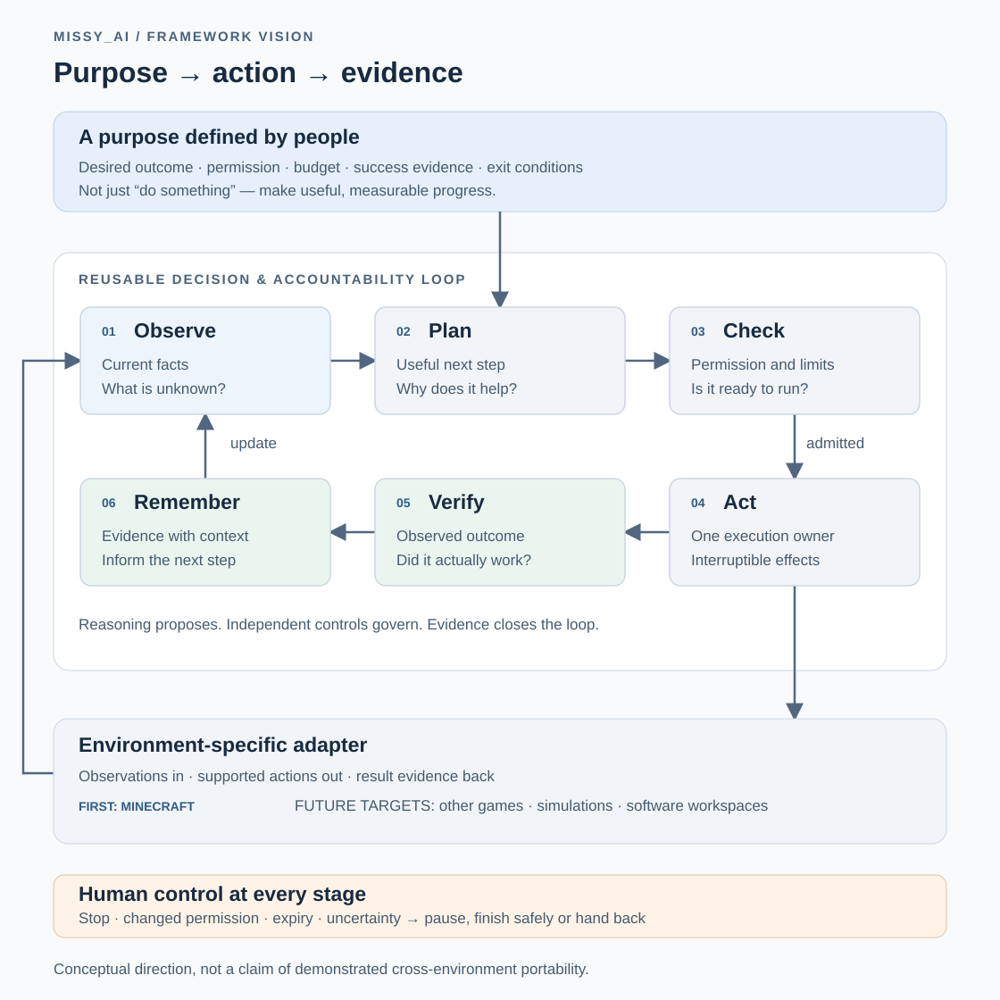

# The design: from purpose to verified progress

[Open the standalone diagram](assets/purpose-framework.html) · [The ambition and roadmap](VISION.md)

The picture is the **conceptual framework direction**, grounded in the observation, review, execution and memory separation used in our Minecraft work. It is not a claim that a production-ready cross-environment SDK already exists.

## Read the loop

### 1. Observe — what is true now?

Receive scoped facts from the environment. Track freshness, missing information and changes. Historical memory can guide attention, but cannot silently replace current evidence.

### 2. Plan — what would help the purpose?

Turn the current situation into a structured proposal: an action or small plan, its expected contribution and relevant limits. Reasoning can suggest work; it cannot grant itself new permission.

### 3. Check — is this action allowed and ready?

Independent controls check current scope, permissions, budgets and environment conditions. The choice can be allowed, blocked or held for more information. A model's confidence is not authorization.

### 4. Act — who owns the effect?

One execution owner manages the admitted action and its cancellation. In Minecraft, the physical movement controller handles movement; we do not ask a model to steer every block. A future adapter would need its own appropriate execution mechanism.

### 5. Verify — what actually happened?

Compare the result with observed effects. An accepted request is not necessarily completed work. A Home return needs physical arrival and recorded outcomes; a future workspace action would need evidence appropriate to that domain.

### 6. Remember — what should inform the next decision?

Keep useful observations and outcomes with their context. A remembered resource location is not guaranteed stock or ownership. An uncertain effect stays uncertain rather than being replayed automatically.

Then observe again. The environment may have changed during the last action. The loop continues only while the purpose, permission and remaining budgets still support it.

## The environment adapter is a contract, not a magic connector

The intended adapter boundary has three responsibilities:

- **Observations in:** expose relevant received state, including what is unknown.
- **Actions out:** expose only supported operations with clear permissions and lifecycle.
- **Evidence back:** describe how attempted, completed, blocked and uncertain outcomes can be distinguished.

Minecraft is the concrete integration today. Other games, simulations and software workspaces are future targets, not installed adapters. Each would need domain-specific skills, checks and acceptance evidence.

## Human control crosses the whole loop

A purpose is bounded authority, not a permanent instruction to keep acting. Human Stop, changed permissions, expiry or unsafe conditions can invalidate work. The executor must honor cancellation, and the system must report what completed, what was released and what remains uncertain.

The conceptual loop does not imply a new independent controller at every step. Our current Minecraft system retains its A observation, B/C review, D execution and E memory responsibilities; verification is explained separately here because it is central to judging results, not because we introduced another actuator.

## A concrete example

**Purpose:** survey a reviewed surface area for useful observations and return Home within the allowed limits.

The bot observes current terrain, proposes a short leg, checks the route and return reserve, executes it, and records verified movement plus observations. If an obstacle invalidates a known released leg, bounded recovery may propose a distinct reviewed route. If the effect is uncertain, it holds instead of pretending nothing happened. The final result must distinguish actual Home arrival from a planned return.

This is how a high-level purpose becomes a sequence of accountable actions—and how the same design question could carry into a different environment.
