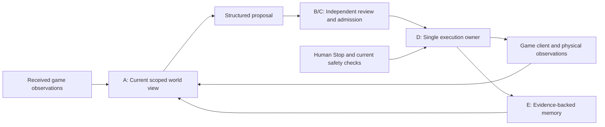

# The design

## Language chooses; deterministic controls govern

A useful suggestion is not permission to act. Missy_AI separates observed facts, proposed behavior, independent validation, physical execution and remembered outcomes.

The diagram is conceptual, not a complete deployment or security specification.

## Five responsibilities

- **A — Observation:** form a versioned, scoped account of what the client actually received. Missing or stale knowledge is not invented.
- **B/C — Review and admission:** check a structured proposal against its current scope, permissions and available budgets. A model cannot grant itself those permissions.
- **D — Execution:** one owner runs the admitted action with current safety checks, cancellation and recorded release. Movement is handled by the existing physical controller, not one model call per block.
- **E — Memory:** retain descriptive observations and verified outcomes. Remembered resources are historical observations, not guaranteed current stock, ownership or yield.

## Bounded exploration

Travel is divided into reviewed legs. Planning reserves room for a return Home; every new leg still needs current checks. Recovery is bounded and opt-in: known released failures can lead to a distinct newly reviewed route, while an uncertain effect is held rather than automatically retried.

A Home return is claimed only from completed physical movement and recorded outcomes—not because a route was planned or a map marker exists.

## Important boundaries

Human Stop, world changes, expiry, obstacles and stale observations can invalidate a plan. Logged-in observers are not automatically obstacles; current occupancy still matters. Unknown outcomes remain unknown. The design does not promise perfect perception, uninterrupted autonomy or autonomous source-code modification.
