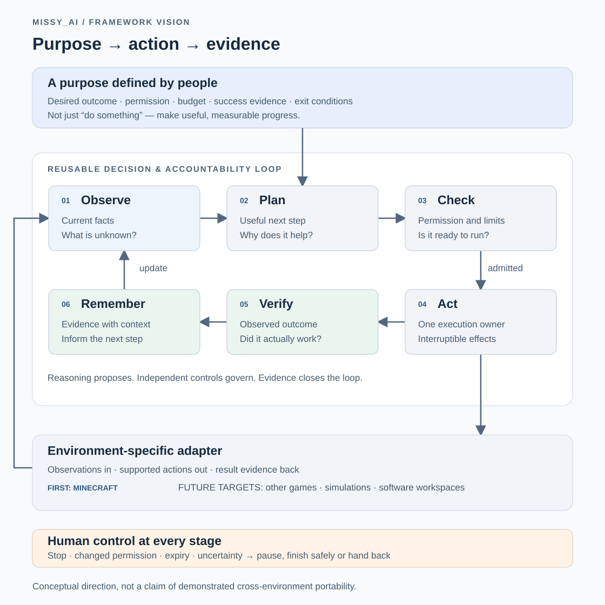

# Missy_AI Bot Player — for Minecraft

### A purpose-driven bot framework. Minecraft is our first proving ground.

**Our aim is to build a bot that can enter an environment, understand a purpose, and make useful, verifiable progress toward it.** Not just chat. Not just trigger tools. Observe what is happening, decide what is worth doing, act within permission, and check whether the result actually helped.

Minecraft gives that ambition a concrete test: the world changes while the bot is thinking. A convincing plan does not move a player, a remembered resource may no longer be there, and leaving Home is easier than reliably returning. Those are useful engineering problems beyond games, too.

[Read the diagram and design →](DESIGN.md)

## The idea: carry the reasoning loop, replace the environment adapter

Today we are developing and testing in Minecraft. Longer term, we want the same core principles to work in other games, simulations and software workspaces. Each environment would provide its own observations, allowed actions and ways to verify results.

That does **not** mean attaching a language model to arbitrary tools and calling it universal. A new environment needs an explicit adapter, permission model, useful skills and its own acceptance tests. Cross-environment portability is our direction—not a capability we have already demonstrated.

## What makes a bot productive?

A purpose turns activity into a standard for success. “Walk around” describes behavior. “Survey a bounded area for useful resources and return Home” describes an outcome with constraints.

We want the bot to:

- **Understand the purpose:** what matters, what is allowed, and when to stop.
- **Choose useful work:** connect each action to the desired outcome instead of staying busy.
- **Use current evidence:** distinguish what it sees now from what it remembers.
- **Verify effects:** a proposed action, an attempted action and a completed result are different things.
- **Handle uncertainty:** pause, ask or replan within scope rather than invent success.
- **Retain useful knowledge:** remember evidence that helps the next decision without treating history as live truth.

## Explore the project

- **[Our ambition and roadmap](VISION.md)** — what the framework should become, and what would prove it.
- **[The design](DESIGN.md)** — the reusable loop, environment boundary and human control.
- **[How we are building it](ENGINEERING.md)** — decisions, failures and evidence behind the approach.
- **[Twitch demos](DEMOS.md)** — planned gallery; verified clip links are pending.

## What we have actually demonstrated

In a controlled Minecraft surface pilot, the bot completed multiple route legs and physically returned Home: approximately **115.5 blocks of summed travel in 6 minutes 49 seconds**, reaching approximately **10.1 blocks from Home**. Total travel is not outward range. This supports a bounded navigation-and-return result, not a claim of general-purpose autonomy.

A later user-started run held on an uncertain movement outcome. We preserved that outcome and closed the session rather than label it a success. Reliable extended operation remains work to prove.

**Evidence snapshot: November 15, 2026.** This showcase is not a live readiness dashboard. Full-hour endurance, long-distance expeditions and productive work across multiple environments are not established by this pilot.

## What this public project contains

Design explanations, the engineering journey and selected demonstration links. **It is not a source-code release or a downloadable framework.** Implementation, accounts, operational configuration, raw records, private conversations and server/world details remain private.

Created for Cristian Guzman Urrutia with AI-assisted development. Minecraft protocol integration builds on the Mineflayer/Prismarine ecosystem; we do not claim to have created that protocol stack.

**NOT AN OFFICIAL MINECRAFT PRODUCT. NOT APPROVED BY OR ASSOCIATED WITH MOJANG OR MICROSOFT.**
